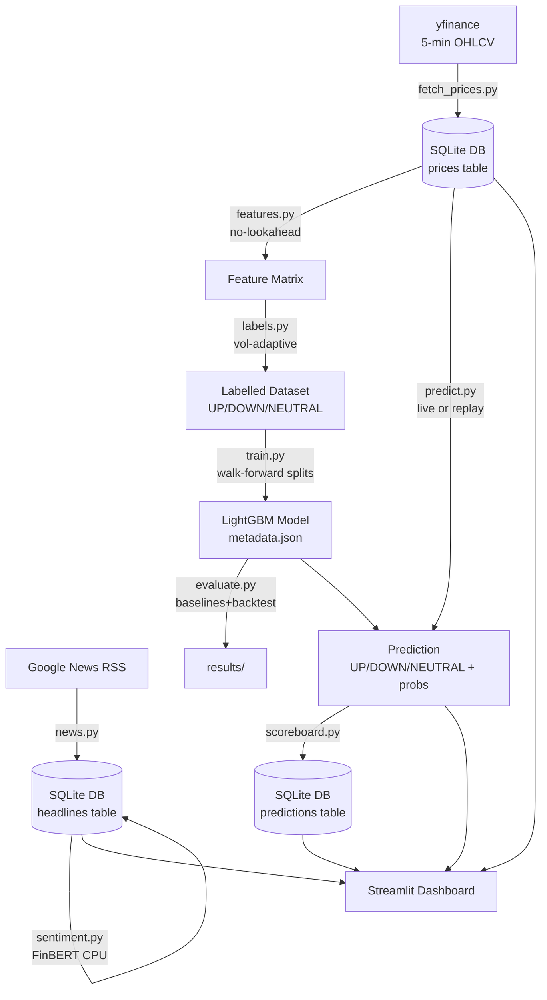

# NSE Intraday Stock Direction Predictor

> ⚠️ **Educational purpose only — NOT financial advice.**
> This project is a machine-learning experiment for learning purposes.
> Never make investment decisions based on this output.
> Short-horizon stock prediction is extremely difficult; markets are approximately efficient.

---

## Architecture



## Project Structure

```
stock-predictor/
├── config.py                 # All constants — no magic numbers elsewhere
├── requirements.txt
├── README.md
├── .gitignore
├── src/
│   ├── universe.py           # NIFTY 100 tickers, validation, company names
│   ├── db.py                 # SQLite helpers (create, upsert, query)
│   ├── fetch_prices.py       # Batched yfinance downloader, incremental
│   ├── features.py           # Feature engineering (strictly no-lookahead)
│   ├── labels.py             # Target creation (volatility-adaptive bands)
│   ├── train.py              # Pooled LightGBM training, walk-forward splits
│   ├── evaluate.py           # Baselines, metrics, cost-aware backtest
│   ├── news.py               # Google News RSS fetcher
│   ├── sentiment.py          # FinBERT scoring + aggregation
│   ├── predict.py            # Single function: live mode + replay mode
│   ├── replay.py             # Replay cursor with no-lookahead guarantee
│   └── scoreboard.py         # Log predictions, resolve outcomes, score
├── app/
│   └── streamlit_app.py      # Dashboard
├── tests/
│   ├── test_features_no_lookahead.py
│   ├── test_labels.py
│   └── test_predict_pipeline.py
├── data/                     # SQLite + parquet (not committed)
├── models/                   # Saved model (not committed)
└── results/                  # Evaluation output (CSV, PNG, summary.md)
```

---

## Setup

### Requirements

- Python 3.10+
- All free tools — no paid APIs or keys required

### Install

```bash
git clone <repo>
cd stock-predictor
pip install -r requirements.txt
```

> **Note on PyTorch:** `torch` can be large (~2 GB). If you only want CPU inference
> for FinBERT, install the CPU-only build:
> ```bash
> pip install torch --index-url https://download.pytorch.org/whl/cpu
> ```

### Environment

No `.env` file is needed. All configuration is in `config.py`.

---

## How to Run Each Phase

### Phase 1 — Data Foundation

```bash
# Full 60-day history (first run; may take 10–20 min due to rate limits)
python -m src.fetch_prices --force-full --universe nifty100

# Incremental update (last 5 days; run daily)
python -m src.fetch_prices --universe nifty100
```

Acceptance check: prints rows per ticker; ≥90% of tickers should have >40 days of data.

### Phase 2 — Features and Labels

```bash
# Run the test suite (all phases)
pytest tests/ -v

# Or specifically
pytest tests/test_features_no_lookahead.py tests/test_labels.py -v
```

### Phase 3 — Model and Evaluation

```bash
python -m src.train
```

This:
1. Loads all data from SQLite
2. Holds out 20% of tickers (seeded)
3. Walk-forward splits with purge gaps
4. Trains LightGBM with class weights and early stopping
5. Evaluates on seen + held-out tickers vs. 3 baselines
6. Saves `models/lgbm_model.pkl` + `models/metadata.json`
7. Writes `results/summary.md`

### Phase 4 — News and Sentiment

```bash
# Fetch and score headlines for a ticker
python -c "
from src.news import fetch_headlines
from src.sentiment import score_headlines, aggregate_sentiment
fetch_headlines('ITC.NS')
score_headlines()
print(aggregate_sentiment('ITC.NS'))
"
```

### Phase 5 — Inference, Replay, Scoreboard

```bash
# Live prediction
python -m src.predict ITC.NS --mode live

# Replay mode (uses DB data)
python -m src.predict ITC.NS --mode replay
```

### Live News Sentiment Integration

The predictor incorporates real-time news headlines (via Google News RSS + FinBERT/lexicon sentiment scoring):
- **Technical Baseline:** LightGBM outputs base probabilities $P_{tech}(UP), P_{tech}(DOWN), P_{tech}(NEUTRAL)$ using 5-minute OHLCV features.
- **News Sentiment Modifier:** Active breaking news in the last 24 hours (e.g. CEO resignation, regulatory actions, major earnings surprise) shifts probability mass proportionally to sentiment score $s \in [-1, 1]$ and headline volume.
- **Explainability:** The dashboard and API explicitly show both the **Technical Indicator Baseline** and the **News-Adjusted Prediction**, providing full transparency into whether a prediction is driven purely by chart patterns or swung by breaking market headlines.

### Phase 6 — Dashboard

```bash
# Start the FastAPI dashboard (then open http://127.0.0.1:8000)
python app/server.py
```

Do not open `app/static/index.html` directly from the filesystem: it needs the
API served by `app/server.py`. The legacy Streamlit dashboard remains available
with `streamlit run app/streamlit_app.py`.

---

## Methodology

### Data

- **Source:** Yahoo Finance via `yfinance` (5-minute bars, last ~60 days)
- **Universe:** NIFTY 100 constituents (`.NS` suffix), validated by trial download
- **Storage:** SQLite with upsert-on-conflict for incremental accumulation
- **Timestamps:** All normalised to `Asia/Kolkata` (IST), filtered to 09:15–15:30

### Features (all scale-free, strictly as-of-time)

| Group | Features |
|-------|----------|
| Returns | Log returns at lags 1, 2, 3, 6, 12 bars |
| Volatility | Rolling std of 1-bar returns at 12 and 36 bars |
| Momentum | RSI(14), MACD histogram (normalised), EMA ratios 9/21 |
| Intraday | VWAP deviation (resets per day), bar range, day-open distance, day-range position |
| Overnight | Overnight gap (open vs prior day's close) |
| Time | Minutes since open (sin/cos encoded), day of week |
| Market context | Nifty lag returns (1, 3, 6 bars), Nifty vol, relative strength |

> **No-lookahead guarantee:** Every feature is computed using only data at or before bar *t*. This is verified by `test_features_no_lookahead.py`.

### Labels

- **Forward return:** `fwd_ret[t] = close[t+3] / close[t] - 1` (3 bars × 5 min = 15 min)
- **Neutral band:** `thr[t] = 0.3 × vol(36 bars) × √3` (volatility-adaptive)
- **Classes:** UP / DOWN / NEUTRAL
- **Cross-day labels are dropped** — no label spans a session boundary

### Training

- **One pooled model** across all training tickers (ticker identity is not a feature)
- **LightGBM multiclass** (3 classes), class weights for imbalance
- **Splits:** 20% tickers held out (seeded); remaining tickers split 60/20/20 by time with HORIZON_BARS=3 purge gaps between splits
- **Early stopping** on the validation fold (50 rounds patience)

### Evaluation

Evaluated on:
1. Test time window, seen training tickers
2. Test time window, held-out tickers (generalization test)

**Baselines:** majority class, momentum (last-bar direction), always NEUTRAL.

**Metrics:** accuracy, macro-F1, per-class P/R, log loss, directional accuracy above confidence threshold, cost-adjusted backtest (0.1% round-trip cost).

---

## Evaluation Results

Trained on 28,420 pooled 5-minute bars across 12 NSE stocks with walk-forward time splits and 3-bar purge gaps. Evaluated on the latest test period against three baselines:

### Test Set: Seen Tickers (9,471 bars)

| Model / Baseline | Accuracy | Macro-F1 | Log Loss |
|------------------|----------|----------|----------|
| **LightGBM (Ours)** | **39.05%** | **0.3827** | 1.0769 |
| Majority Class | 34.58% | 0.1713 | - |
| Momentum (1-bar) | 33.08% | 0.2828 | - |
| Always NEUTRAL | 34.58% | 0.1713 | - |

### Test Set: Held-Out Tickers (2,375 bars — BHARTIARTL.NS, MARUTI.NS, RELIANCE.NS)

*Never seen during model training (generalization test).*

| Model / Baseline | Accuracy | Macro-F1 | Log Loss |
|------------------|----------|----------|----------|
| **LightGBM (Ours)** | **43.92%** | **0.4276** | 1.0547 |
| Majority Class | 35.66% | 0.1753 | - |
| Momentum (1-bar) | 31.96% | 0.2735 | - |
| Always NEUTRAL | 35.66% | 0.1753 | - |

> **Honest Assessment:** While the model achieves a higher Macro-F1 and Accuracy than the trivial and momentum baselines on both seen and held-out test splits, short-horizon stock prediction remains close to a random walk. Outperforming naive baselines by a few percentage points does not imply trading profitability once execution slippage, taxes, and transaction fees (0.10% round-trip) are factored in. The project stands as a rigorous ML engineering benchmark. See `results/summary.md` for full breakdown.

---

## Limitations

1. **60-day history:** yfinance only serves ~60 days of 5-minute data. The model trains on a very short history, which risks overfitting to a single market regime.

2. **Markets are approximately efficient:** At the 15-minute scale, NSE stocks are close to random walks. Even a model with 52–55% directional accuracy may lose money after costs (0.1% round-trip is a significant hurdle).

3. **Backtest is optimistic:** The simple backtest assumes instant fills at the next bar's open, ignores market impact and bid-ask spread, and does not account for position sizing or risk management.

4. **No historical news archive:** Google News RSS only returns the last 24 hours. Sentiment as a model feature requires the system to have been running for days or weeks to accumulate enough labelled headlines. By default, `USE_SENTIMENT_FEATURES = False`.

5. **Regime risk:** A model trained on data from late 2024 to early 2026 may not generalise to different market regimes (sharp crashes, sustained rallies, low-volatility periods).

6. **Data quality:** yfinance is an unofficial API. Data may contain gaps, errors, or adjusted prices that differ from NSE's official data.

7. **No live order routing:** This system cannot place trades. It is purely a research and educational tool.

---

## Decisions Documented (Spec Ambiguities)

| Spec ambiguity | Decision made | Rationale |
|----------------|---------------|-----------|
| Rolling vol features crossing day boundaries | Windows cross days (only intraday-specific features like VWAP, day-open reset) | Spec says "do not compute rolling windows across day boundaries for intraday-only features" — interpreted as VWAP/range/open-distance, not returns/vol |
| `vol_for_label` min_periods | `max(2, VOL_WINDOW // 4)` = 9 bars | Conservative: requires some warmup, avoids excessive NaN dropout at session starts |
| Nifty index volume features | Volume ratio and VWAP not computed for `^NSEI` | Spec §16: "Index tickers often have zero volume; do not use volume features for the index" |
| Sentiment features default | `USE_SENTIMENT_FEATURES = False` | Spec §5.3: sentiment becomes a feature only as an explicit experiment |
| Python version | 3.14 (system-installed) | Spec says 3.10+; 3.14 is compatible |

---

## Disclaimer

This project is for **educational purposes only**. It is a machine-learning engineering experiment, not a trading system. The model's predictions are often wrong. Do not make investment decisions based on this software. Past model performance does not guarantee future results. The authors are not responsible for any financial losses.
